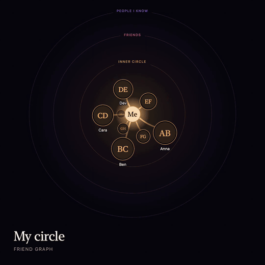
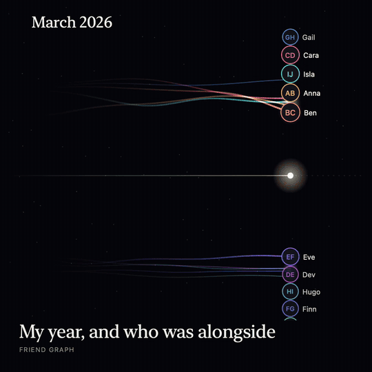
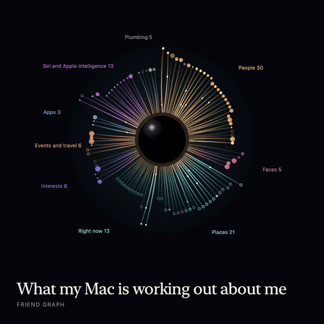
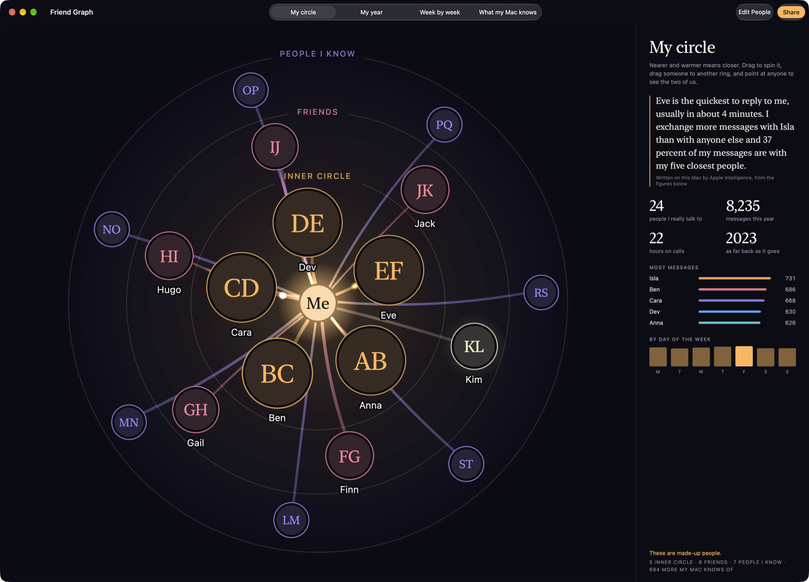
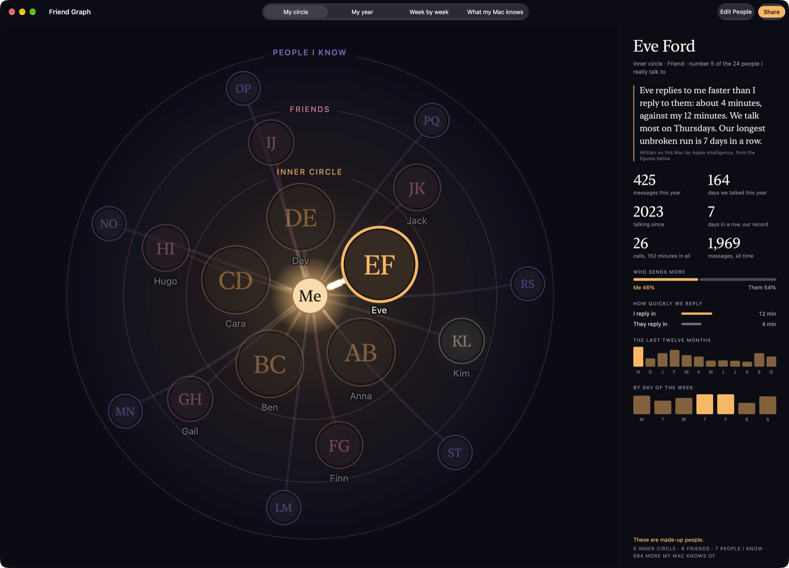

<p align="center"></p>

<h1 align="center">Friend Graph</h1>

<p align="center">See who is really in your circle, from what your Mac already knows.</p>



Your Mac keeps a record of who you talk to, how often, and how quickly you each reply. Friend Graph reads it and draws four pictures:

- **My circle**: the people you really talk to, nearer and warmer the closer you are.
- **My year**: a moving timeline of who was alongside you, as far back as your messages go.
- **Week by week**: a year of conversation, one line per person.
- **What my Mac knows**: everything macOS keeps up to date about you, and how much each part holds.

It can also make **My Film**: a 30 second film of your year, with music, ready to share.

A panel beside each picture pulls out the facts worth knowing, with a short note written on your Mac by Apple Intelligence.

| | |
|---|---|
|  |  |
|  |  |

Everything shown here uses made-up people; the app has a "Try it with made-up people" button so you can look before granting anything. More screenshots and videos are in [docs](docs).

## Privacy

Everything is worked out on your Mac. Nothing is uploaded, there is no account, and the app makes no network requests. It reads who and when, never what was said, and it only reads.

Before any picture is shown you confirm who each person is, and can mark someone as **In memory** or **Leave out**. Shared pictures start with names and photos hidden.

## Requirements

- macOS 27 or later
- Full Disk Access, to read Messages, WhatsApp and the Mac's own record of who you talk to
- Apple Intelligence turned on, for the written notes (optional)

## Build

```sh
brew install xcodegen
xcodegen generate
open FriendGraph.xcodeproj
```

Set your own team under Signing & Capabilities, then run. The first launch walks you through Full Disk Access.

## Good to know

- It relies on files Apple does not document, so a macOS update can break it. It has only been tested on macOS 27.2.
- It is not sandboxed, so it cannot ship on the Mac App Store.
- Closeness is a score built from reply speed, balance, how long and how steadily you have talked, and calls. `FriendGraph/Data/Scoring.swift` explains it and `FriendGraphTests` covers it.

## Credits

Friend Graph was inspired by [iKnow](https://github.com/8rank/iKnow) by 8rank, which first showed what the macOS knowledge graph holds and how to read it. Their [write-up](https://8rank.ai/game/apple-intelligence-personal-knowledge-graph) is the place to start if you want to understand the data.

## Licence

Apache 2.0. See [LICENSE](LICENSE).
